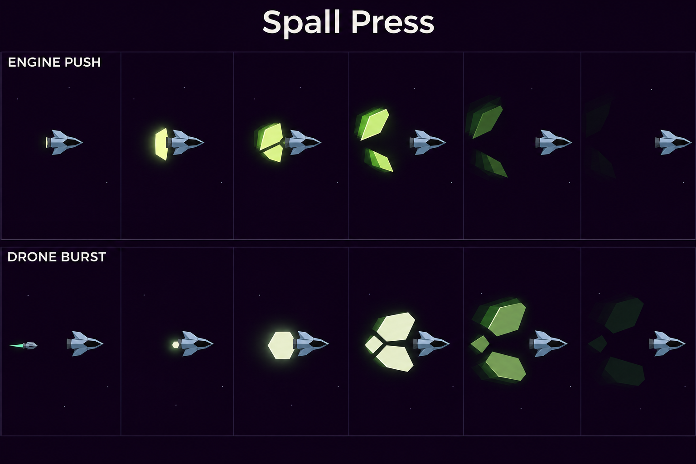
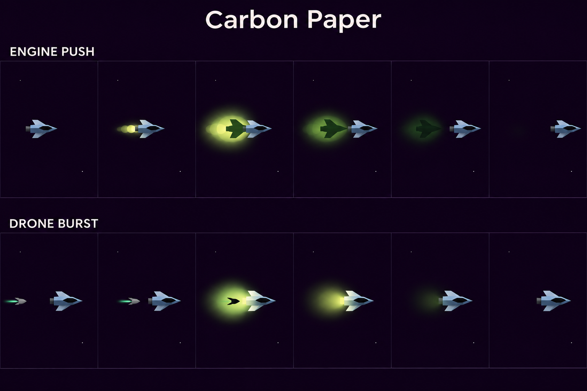
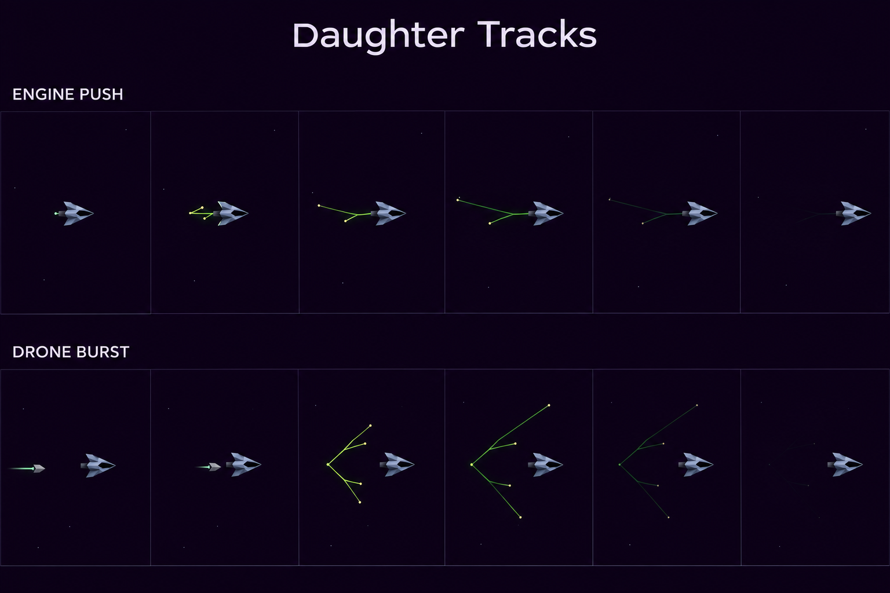

# Void Drift · A nuclear family of explosions

**I’d build Spall Press.** At the first tick of thrust, a broad plate of light forms across the nozzle. The ship moves forward, the plate breaks backward, and a strip of black opens between them. That strip does more to sell the push than a longer or brighter plume would. The drone gets the same material and a different action: its plate breaks open in three directions around the point where the drone disappeared.

## What to take from the period

| Reference | Period observation | Transfer to Void Drift |
|---|---|---|
| **Star Control II — Super Melee** | **Checked.** The Thraddash Torch accelerates and leaves a damaging wake that a pursuer can fly into. The Shofixti Scout carries a close-range detonation capable of killing a much larger ship. One event draws a path behind a surviving craft. The other ends at the position of a disappearing craft. [Melee screenshots, including “Ka-blooey!”](https://www.mobygames.com/game/179/star-control-ii/screenshots/) · [Torch](https://wiki.uqm.stack.nl/Torch) · [Glory Device](https://wiki.starcontrol.com/index.php/Glory_Device) | Let the player see **what leaves the origin**. For thrust, it’s the ship. For detonation, it’s the light. Since Void Drift’s engine wake is assumed harmless, let its contrast fall as soon as it detaches. |
| **Master of Orion I** | **Checked against a documented comparison with DOS v1.3.** A tester found that ordinary hits scaled the explosion with damage, while eliminating the last ship in a stack produced the large explosion even on a small final hit. A reimplementation accidentally reversed those cases. [DOS combat screenshot](https://www.mobygames.com/game/212/master-of-orion/screenshots/dos/570439/) · [Comparison](https://github.com/1oom-fork/1oom/issues/1) | Give destruction a distinct **ending pose**. A drone can deliver its full payload against a surviving target. Reserve the loss of the target silhouette for an actual kill. |
| **Master of Orion II** | **Checked.** A warp-drive failure can destroy the ship and damage neighbours. A player account identifies the breach by its blue explosion. The Plasma Web has a different sequence: projectile, attachment, then diminishing damage over later turns. [Battle screenshot in the Windows gallery](https://www.mobygames.com/game/182/master-of-orion-ii-battle-at-antares/screenshots/) · [Player account](https://www.orionsector.com/pages/moo3/etc/moo2shiparchive.php) · [Drive failure](https://videolamer.com/master-of-orion-2-the-battle-at-antares) · [Plasma Web manual entry](https://www.manualshelf.com/manual/games-pc/master-of-orion-ii-battle-at-antares/user-guide-english/page-96.html) | Colour can name the material. **What the light follows** tells the player what that material is doing. Keep a spent detonation in world space. Light that clings to the enemy suggests an ongoing condition. |
| **Asteroids — arcade** | **Checked against the vector ROM.** The ship explosion has six short strokes, each with its own velocity. Shot impacts use four slightly expanded versions of one shrapnel pattern to bridge the hardware’s coarse scale steps. Two kinds of destruction read differently using monochrome marks. [Vector drawings and original tables](https://computerarcheology.com/Arcade/Asteroids/VectorROM.html) | Author the relationship between pieces. Two fragments that visibly fitted together a moment ago convey rupture at a size where fourteen random sparks convey glitter. |
| **Missile Command — arcade** | **Checked.** A gameplay still shows narrow red incoming tracks and a filled cyan blast. The video hardware allowed cheap palette cycling for explosions. A single bounded shape could change internally while its occupied area remained legible. [Gameplay screenshot, first page](https://static1.squarespace.com/static/555e5d9ae4b0b614ae7344b0/t/55679970e4b0e9e465255184/1432852848109/MissileCommand.pdf) · [Video memory](https://6502disassembly.com/va-missile-command/videomem.html) | Spend colour changes **inside** one silhouette. An expanding filled boundary makes a strong promise about danger radius. Use that promise only when the game can honour it. |

## Three fission families

The three concept sheets each show six moments per subject. They are shape studies. The timings and dimensions below are the intended gameplay versions, and the sheets keep the target visible to give a consistent scale reference.

I use **L** for the firing fighter’s on-screen length, assumed **32 px** here. Tick 0 is the first physics tick of thrust or detonation. Thrust occupies ticks 0–10. The next push begins at tick 27 or 54. At the supplied FX half-life, a stamp retains 50% after six ticks, 25% after twelve and about 6% after twenty-four. Stopping emission early therefore matters more than choosing a darker final swatch.

### 1. Spall Press

A fission pulse makes a transverse plate of light that breaks like a glazed tile. The engine shears it rearward in two unequal pieces, while the drone splits it around a three-way seam.

| Ticks | Engine push | Drone burst |
|---|---|---|
| **0–1** | A pale stroke sits flush across the nozzle on the first thrust tick. It widens to **0.65 L** across and just **0.12 L** fore–aft. | Stop mint emission. At the last drone position, a pale lozenge opens to **0.45 L** across. Keep its brightest edge on the drone side of the contact. |
| **2–4** | The plate reaches peak width. It detaches on tick 2. A diagonal joint opens to **2 screen px** between a large upper piece and a smaller lower piece. | The lozenge reaches **0.8 L**. Three unequal polygons part along a Y seam. By tick 4 there is sky at the origin. |
| **5–10** | Both pieces translate aft without rotating. The small piece travels farther. By the end of thrust the nozzle has cleared both, even when the ship began at rest. | Pieces travel outward to **0.9 L radius**. Turn the widest gap toward the target so at most one narrow edge crosses its hull. |
| **11 onward** | No new light during the wait. The last green impressions decay at their deposited positions. | Remove live edges by tick 14. The three dim impressions linger for roughly another twelve ticks. |

**Paint.** Cache two trapezoids and a three-piece lozenge. On FX, stamp only the **outer third** of each moving face at ticks 2, 5 and 8, around 20% opacity. Screen overlap makes stepped green shoulders. Redraw the actual faces on LFX, with a pale leading lip and a transparent seam. A dark stripe painted across a solid FX plate would lose the seam as soon as LFX stopped. Leaving the joint unpainted preserves it.

**Colour and scale.** Use `#f4ffd9` for the lip, `#b8ed43` for the brief face and `#38752b` for the deposited edges. The broad crosswise front separates it from the longitudinal mint and cyan engines. Its leaf-green decay distinguishes it from amber heat and violet gravity. UI lime never gets a stable, intact tile to compete with. For a larger event, split the largest chip once more after tick 8. Keep the unequal pieces and the clean joint.

**Cost and failure.** At drone peak, three LFX faces and three lips per frame, plus nine FX impressions over the event. The failure mode is **loot**: independently tumbling luminous polygons look collectible. Keep their orientation fixed and let the matching cut edges remain recognisable for four ticks.

### 2. Carbon Paper

The flash leaves a dark contact print of the machine that produced it. On thrust, the stern pulls free of its own impression; on detonation, a small image of the vanished drone hangs briefly beside the target.

| Ticks | Engine push | Drone burst |
|---|---|---|
| **0–2** | Stamp three overlapping sulphur ovals aft of the moving nozzle, one per tick. Together they expose a patch **0.7 L wide × 0.45 L long**. Peak on tick 2. | Cut mint emission. Centre one asymmetric oval on the drone’s last pose, with the short side toward the enemy. Expose it twice, reaching **1.3 L** along its long axis. |
| **3–6** | Inside the patch, hold a dark print of the **aft third** of the ship at its tick-0 pose. Clip it to the lit patch. The live nozzle moves clear. | The drone is gone. Its silhouette remains as a dark cutout, at the drone’s actual projected size. Give the target’s nearest facing facet one pale tick at impact. |
| **7 onward** | Lift the print over ticks 7–10. During the wait only the FX exposure fades. At the slow cadence the engine spends most of the cycle dark. | Lift the print over ticks 7–12. The asymmetrical patch decays in place. The target carries away no residual mark. |

**Paint.** FX gets one cached soft-edged oval at three offsets. The first exposure is pale and small, the following exposures greener, larger and weaker. On LFX, one cached silhouette filled `#102619` at about 80% darkens the accumulated light underneath it. Clip that mark to the oval and exclude the current live hull. The dark print depends on having light beneath it, which makes hard-light particularly useful here.

**Colour and scale.** Expose with `#f6ffd0`, shoulder through `#b8de51`, and use `#558539` around the perimeter. The deep green silhouette carries identity through a pale overlap with mint or cyan. The cool shadow also separates it from atmospheric orange, plasma and violet. The asymmetric exposure and recognisable machinery cutout keep it away from a UI selection halo. For a capital event, expose the silhouette of a distinct engine bank or docking fork. Keep the print at the **actual size of its source** as the lit field grows.

**Cost and failure.** Two or three FX stamps per event, one LFX mask per frame and one optional facet fill. The risk is a phantom second ship. The concept sheet shows that risk clearly. For gameplay I would crop the engine print at the stern and lift it within ten ticks. The drone earns a full silhouette because the original has disappeared.

### 3. Daughter Tracks

A grain of light draws a short track, divides once, and sends unequal daughters away from the joint. The engine writes one backward fork; the drone writes two forks from a common point.

| Ticks | Engine push | Drone burst |
|---|---|---|
| **0–2** | One ivory grain starts at the nozzle and draws **0.18 L** straight aft. Freeze the firing axis at ignition. | End mint emission. Two grains leave the drone position in roughly opposing directions, one passing across the target’s near edge. |
| **3–7** | Split into two grains at an included angle of **38°**. The longer daughter reaches **0.9 L** from the joint, the shorter **0.45 L**. The separating tips produce the peak. | Split each parent once, on ticks 3 and 5 respectively. Four daughter tips reach **0.6–1.3 L**. The later split makes the sequence readable even when a player misses ignition. |
| **8 onward** | Extinguish the short tip at tick 8, the long tip at 10. The oldest stem fades first. No new tracks during the wait. | End tips successively over ticks 9–14. Old segments fade in birth order, leaving two or three disconnected terminal dashes before darkness. |

**Paint.** FX gets only the segment travelled **this tick**, one stroke per active tip. Give adjacent segments round ends and about half a pixel of overlap. Screen blending picks out each junction. Repainting the full polyline every tick would turn the root white and reverse the intended decay. LFX gets a **1.5–2 px** pale lozenge at each live tip. At this width the full-resolution stroke carries the shape; the eighth-resolution glow contributes little.

**Colour and scale.** Use `#f1ffd5` tips and `#a6e838` fresh strokes, with a single `#448329` root impression. Older strokes dim naturally on FX. Yellow-green branching distinguishes the tracks from mint or cyan jets, orange plasma and violet gravity. The critical collision is with the green speed lines: every fission stroke must share a visible **fork**, with a shorter and a longer daughter. A larger event can branch one daughter again. Cap it at eight tips.

**Cost and failure.** Up to two moving tips for the engine, four for the drone. Each costs one short FX stroke and one LFX lozenge per tick. At minimum zoom the fork can collapse into a straight green speed line. Keep at least **3 px between daughter endpoints** and a **1.25 px stroke**. This family is the most sensitive to camera scale.

## Decision

**Spall Press is the best fit for Void Drift.** At 32 px, the proposed engine plate is about 21 px across and 4 px thick. That is enough room to see a solid front, a fracture and two matching pieces. The plate also belongs beside the game’s faceted hulls. Carbon Paper makes the best use of hard-light, but it needs a recognisable source silhouette. Daughter Tracks gives the drone an excellent signature, but asks the engine to sell a heavy push with two thin lines.

For a first in-game check, I’d run **Spall Press from rest, at full lateral drift, and with the stern crossing a charcoal hull**. At tick 1 the plate should touch the nozzle. By tick 5 there should be visible sky in the fracture. At the next fast pulse the previous plate should read as spent. Those three frames would tell me more than a larger render.

Three answers would change the implementation:

1. What are the **smallest projected fighter, nozzle and drone widths** at combat zoom? The nozzle width sets the plate’s starting size. The minimum drone width decides whether Carbon Paper is viable.
2. How far does the nozzle actually move over **ticks 0–4 and 0–10**, starting from rest? That determines how much rearward fragment travel the artist must supply to open the gap.
3. Is drone damage resolved **once at proximity trigger**, or does it occupy a radius for several ticks? I assumed one damage tick and a harmless afterimage. A live damage volume needs a readable extent for its full lifetime.
