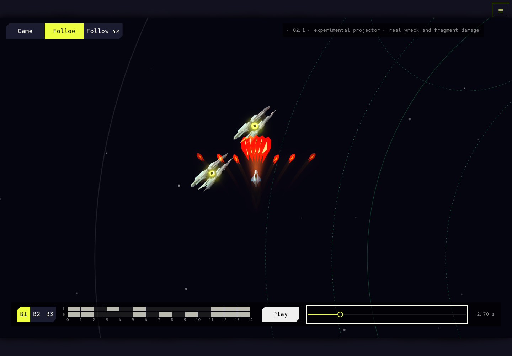
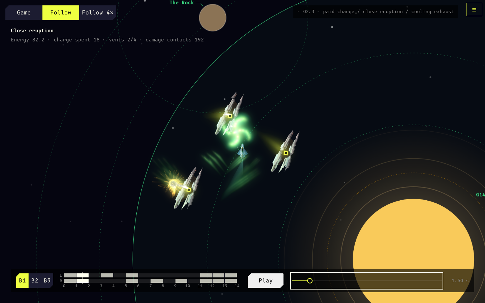

# Plasma Projector exploration reset · 16 November 2026

## Scope and assessment

The designer rejected every current-study exploration attempt, 02.1 through 02.3
including the replacement of 02.3. None establishes a useful weapon-design result.
The captures below are evidence of unwanted directions, not design references.
The study remains open; this record closes the rejected implementation attempts.

The designer reported that the later effects belonged to the game’s rendering
language but did not express the intended plasma weapon. The designer described
successive attempts as moving farther from the goal.

## Reported actions and direct inspection

In the self-assessment supplied in chat, the replacement agent acknowledged copying
and transforming the rejected 02.3 simulation and wrapper while replacing its
painter. It reported retaining a stationary circular blast and branching moving
parcels. Its earlier explanation emphasised implementation checklists and weak visual
inspection; its later explanation identified reuse of rejected implementation.
These are attributed explanations, not established general harness causes.

At cleanup, both implementations were present: Plasma023.svelte, round023.ts,
round023-paint.ts, round023.check.test.ts, Eruption023.svelte, eruption.ts,
eruption-paint.ts and staging.check.test.ts. Repository reference search found
consumers only within this study. All eight files and the active page’s instrument
imports were removed. Shared Flight, rendering and damage tooling remain.

The page’s 02 content was cleared. Section 01 retains the designer’s mechanism,
effect-family identity and the earlier 11 November study’s timing, release-kick,
cost and recovery hypotheses. The next delivery is one visual firing sequence.

## Captures

02.1 original caption: B1 / Course, 2.70 s, Follow 1.6×, 1440 px viewport;
complete commitment, persistent discharge light on, all production layers visible,
placed targets, standard Wasp engines and stabilizers. Still appearance only.

Original 02.3 caption: B1 / Close pass, 1.50 s, Follow 1.6×, 1440 × 900,
default 65 u/s preparation response. This predates the interrupted replacement;
it does not depict that replacement’s final state.

## Checks and evidence limits

The retired pages reported simulation/contact/replay successes for earlier attempts.
Those reports do not establish visual quality or acceptance; historical checks were
not rerun for this reset. The interrupted replacement page said verification was
in progress. Its agent reported incomplete motion inspection and cleanup.
No capture of that replacement was available in the study’s versioned assets.
No motion recording is retained here.

This cleanup creates no production decision and changes no specification.
No commit, push or deployment was performed by the cleanup session.
