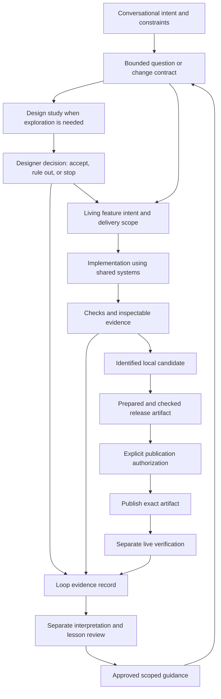

# The factory and its documented evolution

Void Drift is a procedural space-survival game and a deliberate experiment in voice-led, design-led development. The game provides concrete work through which to study the factory. The archived [rebuild charter](../../history/rebuild-charter.md#purpose) explicitly adopts selected ASDLC ideas as design inputs; the current [vision](../../vision.md) also identifies learning for future builders as part of the project's value. This establishes intentional use, not independent experimental validation of the framework. See E-R01 and E-L09 in the [source register](01-method-and-sources.md).

## How work is organised

The designer supplies intent and makes consequential design and scope decisions through conversation. Agents inspect context, translate the request into bounded work, implement, verify, and retain evidence. The Lab supplies inspectable game and component examples. Local changes, commits, publication and verified live behavior have distinct meanings and authority boundaries. Current instructions permit local implementation within agreed scope and require explicit authorization for pushing, publishing or external feedback. People's playtesting is outside the repository process. These are current operating instructions, not a claim that every historical session followed them. [AGENTS.md](../../../AGENTS.md), E-R02.

This diagram synthesises the documented routes. It is not an executable orchestration graph. A stopped study can close without implementation; a feature need not initiate a new study; release preparation does not itself establish full correctness. Human design decisions occur during exploration as well as at boundaries. E-D01, E-G02–04, E-L04, E-R04.

## Sources of authority and implementation

| Surface                                   | Role in the factory                                                     | Boundary                                                                 |
| ----------------------------------------- | ----------------------------------------------------------------------- | ------------------------------------------------------------------------ |
| `AGENTS.md`                               | Small repository map, context routes, working authority                 | Prose steers agents; it is not by itself a mechanical barrier            |
| Vision, design and architecture documents | Intent, visual principles and ownership                                 | Current decisions take precedence over historic plans                    |
| `docs/specs/`                             | Living game, Lab and factory behavior contracts                         | Intent is distinct from checked delivery status                          |
| Skills and their references               | Task-specific procedures                                                | Availability does not prove invocation or effectiveness                  |
| Plans and conversation                    | Work selection, questions and execution deltas                          | Plans explicitly go stale; retention is not continuing authority         |
| Lab and study pages                       | Controlled examples, comparisons and durable design records             | A useful instrument, accepted design and integrated feature are distinct |
| Core / Mode A / web                       | Shared engine and visual definitions / game rules / surfaces and wiring | Sharing definitions does not make a study fixture the complete game      |
| Verification and release scripts          | Mechanical checks, source/artifact identity and deployment operations   | Quality, permission and live readiness remain separate claims            |
| Loop records and lessons                  | Attributable observations and separately reviewed interpretations       | Recording, adopting and validating a lesson are distinct                 |

Sources: [architecture](../../architecture.md), [design-study contract](../../specs/lab/design-studies/spec.md), [development](../../development.md), [plans instructions](../../plans/AGENTS.md), E-D01, E-G01–04, E-R02–05.

The shared-system claim has a concrete implementation counterpart: `FlightDeck` imports Core and Mode A simulation/rendering systems, while `IonCannonFlight` consumes shared drawing and engine functions in a controlled local fixture. This is evidence of reuse, with a clear limit: that fixture does not exercise the entire production loop. E-R05.

## Gate anatomy at the baseline

Full verification names nine stages: contracts, commit syntax, lint, types, unit tests, build, browser, rules and competition. Quick verification selects four and always marks itself partial. Reports identify source revision, dirty state, environment, selected/skipped steps and source stability. Historical failed runs remain failed even when a later candidate passes. The release workflow prepares a build, checks its manifest, publishes a checked copy and records live verification separately. E-G02, E-G04 and E-R03–04.

| Claim                               | Evidence capable of supporting it                             | What it does not establish                             |
| ----------------------------------- | ------------------------------------------------------------- | ------------------------------------------------------ |
| Selected quick checks passed        | Identified partial report                                     | Full verification                                      |
| Full required checks passed         | Full report, unchanged candidate, stage outcomes              | Complete design quality or all possible correctness    |
| Artifact prepared                   | Production build, offline smoke, settings and manifest checks | Publication or live service readiness                  |
| Artifact deployed                   | Attempt-specific deployment result                            | A successful live journey                              |
| Designer accepted a design property | Recorded decision with scope                                  | Integration, release or general workflow effectiveness |
| Lesson adopted                      | Authorized guidance change                                    | Improvement on subsequent comparable work              |

Documentation and operating procedure require authorization before invoking publication. The inspected release function enforces bundle identity, not permission; no repository approval-token enforcement was established. Similarly, selected review episodes demonstrate critic involvement, but the assessment does not establish a universal automated adversarial-review gate. These are descriptions of the observed operating model, not project change requests.

## Dated evolution

| Period                | Documented development                                                                                                          | Interpretation limit                                                                                  |
| --------------------- | ------------------------------------------------------------------------------------------------------------------------------- | ----------------------------------------------------------------------------------------------------- |
| 28 October            | Rebuild charter, playable-alpha factory and button study connect spoken intent, executable checks and shared visual definitions | Retrospectives describe the early state; today's runner did not exist unchanged then                  |
| 29 October            | Planetary inquiry cycles expose purpose/scope distinctions; phased studies are adopted                                          | Partial useful work coexists with an unsuccessful study; adoption is not efficacy                     |
| 31 October–2 November | Ion-stream and utilities failures retain disagreement and technical-check limits                                                | No common internal model cause is established                                                         |
| 3 November            | Release preparation, context ownership and optional study evaluation receive explicit amendments                                | Mechanism tests do not validate study-method improvements                                             |
| 5–8 November          | Release records distinguish fixture failures, runner defects, stable candidates and live checks                                 | Retained reports certify particular runs, not all intervening work                                    |
| 8 November            | Retrospective corrects guessed causes, records the playtesting boundary and removes hosted CI                                   | Absence of hosted CI is a deliberate recorded operating choice; no universal judgment follows         |
| 9–11 November         | Accepted point-defence and stopped ship-slot studies show different outcomes; writing/closure guidance is amended               | Design approval can coexist with later factual corrections; new guidance is not yet efficacy evidence |
| 12 November           | Practice G7 and seeded yellow-family records describe distinct mode changes and their evidence limits                           | Their historical dirty-tree statements are not the assessment's current checkout status               |

Primary episodes and interpretation limits are in [case studies](04-case-studies.md); detailed anchors are in the [design](evidence/design-and-context.md), [gates](evidence/gates-and-delivery.md), and [learning](evidence/learning-and-history.md) packets.

The resulting factory is best described as a human-directed, conversational workflow with substantial executable verification and explicit evidence boundaries. It uses many ASDLC mechanisms and adapts their organisational form to an expressive game and a small design-led setting. The record does not support a productivity multiplier, an optimal autonomy level, a measured model-routing advantage, or a claim that procedural amendments solved repeated design failures.
