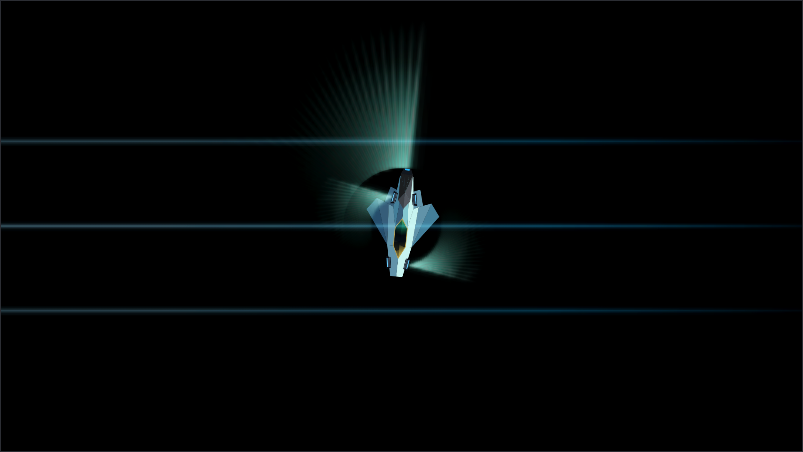
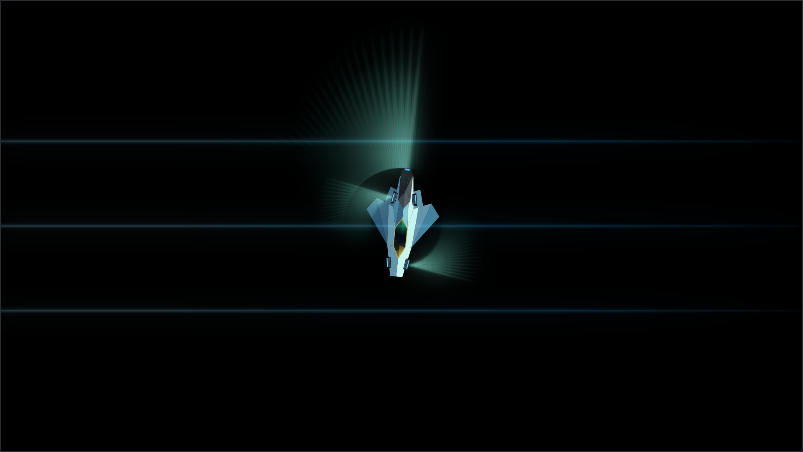

# Glow comparison at 25 scenarios · 20 November 2026

Both low-res glow treatments restored Safari to 60.00 callbacks/s in the 25-scenario Lab fixture. Turbulent Bloom averaged 36.63 callbacks/s, with a p95 interval of 28 ms versus 18 ms for either low-res treatment. In Chrome, the pooled rates ranged from 117.66 to 120.00 callbacks/s against a 119.76 callbacks/s blank baseline.

The separate Chrome trace recorded shorter compositor events for Low-res glow than for Low-res CSS glow. The extra blur is a visual choice with measurable compositor work in that trace. Rendering headroom and behavior in moving flight remain open.

## Treatments

The 21 November implementation adopted [Low-res CSS glow](../specs/game/render/fx.md#low-res-css-glow)
as the shared flight default. The setup below describes the comparison as run on
20 November.

Both choices are Lab-only options on the FX selector in Render Model and Render Performance. Production uses Turbulent Bloom by default. The two options share one stage-wide 240 × 135 glow canvas, derived after each draw from the 1920 × 1080 FX canvas. The browser scales it smoothly across the stage and composites it with Screen blend at 90% opacity, between FX and LFX. The original FX canvas continues to supply the unfiltered image. Only the original FX surface stores history.

| Treatment | Presentation |
| --- | --- |
| None | Full-resolution FX with no filter or added glow canvas |
| Turbulent Bloom | Shared SVG filter, 12 CSS px glow, 16 CSS px displacement, and 90% strength |
| Low-res glow | Fable’s 1/8-per-axis copy with smooth browser scaling |
| Low-res CSS glow | The same low-res copy with native CSS `blur(12px)` on the glow canvas |

[Render Model contract](../specs/lab/render-model/spec.md#lab-glow-treatments) · [Render Performance contract](../specs/lab/render-performance/spec.md) · [Shared flight layer host](../../apps/web/src/components/FlightLayers.svelte)

## Measurement setup

The Render Performance bench ran 25 rotating Wasps in a 5 × 5 grid at 1.5× scale, using the Lab's scripted render fixture. The workload alternates ion and plasma main plumes, adds stabilizer plumes and fires three synchronized ion beams per scenario. All treatments use the same FX history surface and stamp budgets. World, FX and LFX each use a 1920 × 1080 backing.

Desktop Safari 26.6.2 and Google Chrome 157.0.8103.80 ran in visible foreground tabs on an Apple M4 Max with 36 GB of memory, under macOS 26.7.3 (25G342). The built-in display reported 120 Hz and DPR 2. Both stages measured 847 × 476.44 CSS px including the border. Safari ran at a 1512 × 859 viewport with a stage-clipped 845 × 479.70 canvas box. Chrome ran at 1512 × 785 with an 845 × 474.44 canvas box. Geometry was fixed within each browser’s comparison.

Safari used a regular tab in the installed application with a local recording proxy and script. Playwright drove the installed Chrome application in a visible window. The recorder timed the bench’s existing render loop with its original rendering recipes.

Each treatment ran twice. The harness reset the scene before each run, warmed up for 5.2 seconds and recorded at least 30.05 seconds of callbacks. Blank tabs established baselines of 60.11 callbacks/s in Safari and 119.76 in Chrome. In each browser the completed windows ran in the order None → Low-res glow → Turbulent Bloom → Low-res CSS glow → Low-res glow → None → Low-res CSS glow → Turbulent Bloom.

**Callback intervals** come from elapsed timestamps of the bench’s animation callbacks across the complete measurement windows. Rates and percentiles aggregate both windows, with replicate rates shown in parentheses. **Bench JS** is the bench’s synchronous update and Canvas submission time, from the final rolling ten seconds of each run. It includes drawing the glow copy where applicable. The **full tick** column below measures the complete synchronous callback across both 30-second windows. Display presentation and GPU completion were outside the timing scope.

## Results

### Safari

| FX treatment | Intervals | Callbacks/s (each run) | Interval p50 / p95 / max (ms) | Intervals >20 ms | Bench JS p50 / p95 (ms, each run) |
| --- | ---: | ---: | ---: | ---: | ---: |
| None | 3,606 | 60.00 (60.00 / 60.00) | 17.0 / 18.0 / 21.0 | 1 (0.03%) | 1.00 / 2.00 · 1.00 / 2.00 |
| Turbulent Bloom | 2,202 | 36.63 (36.68 / 36.57) | 27.0 / 28.0 / 33.0 | 2,202 (100.00%) | 1.00 / 1.00 · 1.00 / 1.00 |
| Low-res glow | 3,606 | 60.00 (60.00 / 60.00) | 17.0 / 18.0 / 21.0 | 1 (0.03%) | 1.00 / 2.00 · 1.00 / 2.00 |
| Low-res CSS glow | 3,607 | 60.00 (60.00 / 60.00) | 17.0 / 18.0 / 21.0 | 1 (0.03%) | 1.00 / 2.00 · 1.00 / 2.00 |

### Chrome

| FX treatment | Intervals | Callbacks/s (each run) | Interval p50 / p95 / max (ms) | Intervals >20 ms | Bench JS p50 / p95 (ms, each run) |
| --- | ---: | ---: | ---: | ---: | ---: |
| None | 7,073 | 117.66 (120.00 / 115.32) | 8.3 / 10.4 / 16.6 | 0 (0.00%) | 1.00 / 1.80 · 0.80 / 1.40 |
| Turbulent Bloom | 7,214 | 120.00 (120.00 / 120.00) | 8.3 / 8.5 / 9.4 | 0 (0.00%) | 0.90 / 1.40 · 0.80 / 1.40 |
| Low-res glow | 7,213 | 119.99 (119.97 / 120.00) | 8.3 / 8.5 / 16.6 | 0 (0.00%) | 0.90 / 1.40 · 0.90 / 1.40 |
| Low-res CSS glow | 7,100 | 118.11 (120.00 / 116.22) | 8.3 / 9.8 / 12.6 | 0 (0.00%) | 0.90 / 1.50 · 0.80 / 1.40 |

The second None and Low-res CSS glow windows fell to 115.32 and 116.22 callbacks/s while retaining focus. Each treatment reached 120.00 in its other window. The near-refresh-rate Chrome results leave a small treatment effect unresolved.

### Stamp workload

Stamp totals are differences between the bench counters at sample boundaries, with those counters refreshed every 250 ms. Some stamps are issued once per callback, so slower callback pacing also reduces attempted and accepted stamps over a fixed interval. Safari’s Turbulent Bloom samples attempted 258,684 stamps, compared with 413,245 for Low-res glow and 416,333 for Low-res CSS glow across the two windows per treatment.

| Browser | FX treatment | Attempted | Accepted | Dropped | Full tick p50 / p95 / max (ms) |
| --- | --- | ---: | ---: | ---: | ---: |
| Safari | None | 416,113 | 398,535 | 17,578 | 2.0 / 4.0 / 7.0 |
| Safari | Turbulent Bloom | 258,684 | 246,870 | 11,814 | 1.0 / 1.0 / 2.0 |
| Safari | Low-res glow | 413,245 | 396,591 | 16,654 | 2.0 / 3.0 / 6.0 |
| Safari | Low-res CSS glow | 416,333 | 398,271 | 18,062 | 2.0 / 4.0 / 7.0 |
| Chrome | None | 825,277 | 787,173 | 38,104 | 1.9 / 3.0 / 6.1 |
| Chrome | Turbulent Bloom | 835,782 | 799,614 | 36,168 | 1.7 / 2.7 / 4.6 |
| Chrome | Low-res glow | 845,588 | 807,330 | 38,258 | 1.8 / 2.9 / 6.6 |
| Chrome | Low-res CSS glow | 826,537 | 788,829 | 37,708 | 1.8 / 2.6 / 4.8 |

### Chrome compositor trace

A separate Chrome run recorded one 6.5-second trace window per treatment at approximately 120 callbacks/s. The p95 durations are for CPU-side Chrome trace events on the compositor thread. The pass counts divide GPU-process paint-render-pass events by compositor draws as a rough per-draw measure. The trace does not time GPU execution.

| FX treatment | Draw and swap p95 (ms) | Draw frame p95 (ms) | Paint-render-pass events per draw |
| --- | ---: | ---: | ---: |
| None | 0.116 | 0.061 | ~2 |
| Turbulent Bloom | 0.221 | 0.165 | ~3 |
| Low-res glow | 0.120 | 0.062 | ~2 |
| Low-res CSS glow | 0.178 | 0.119 | ~3 |

Low-res glow is the lighter measured option if the tighter halo is acceptable. Low-res CSS glow offers the wider halo while retaining near-baseline callback pacing in these runs.

[Chrome trace summary](../../artifacts/render-glow-performance/trace-summary.json) · [Compressed trace](../../artifacts/render-glow-performance/chrome-trace.json.gz)

## Inspector appearance

The captures hold one painted Wasp frame at the same presentation time. With Low-res glow, the additional light stays close to the beams and the brightest parts of the plume. The CSS blur spreads that light into a wider, dimmer halo. The difference is subtle at this stage size, and the beam and plume cores remain defined in both.

| Low-res glow | Low-res CSS glow |
| --- | --- |
|  |  |

## Verification and limits

The Lab correctness checks exercised selection on held FX, pause and resume, reset, visibility, resizing and copied metadata. Svelte, Astro, lint, spec and contract checks passed separately from the timing runs. The earlier title-screen observation used a different CSS area and workload.

Safari restarted three interrupted windows after the tab lost foreground focus. All 16 measured windows retained focus and visibility throughout. Chrome reported an Apple M4 Max ANGLE Metal renderer with GPU Canvas 2D, compositing and rasterization enabled. Chrome’s blank calibration page requested a missing favicon. The bench navigation completed and the trace reported zero console errors.

The shared preview served the local working tree based on `cea473654c16ffe3cba7f88e820142c509895ea0`. The rendering source fingerprints matched their recorded values after the runs. The measurement artifacts below are local to the checkout.

[Safari raw windows](../../artifacts/render-glow-performance/safari-visible.jsonl) · [Chrome raw windows](../../artifacts/render-glow-performance/chrome-visible.jsonl) · [Summary and copied results](../../artifacts/render-glow-performance/summary.json) · [Chrome graphics features](../../artifacts/render-glow-performance/chrome-visible-system.json) · [Rendering source fingerprint](../../artifacts/render-glow-performance/render-source-mid.txt)
