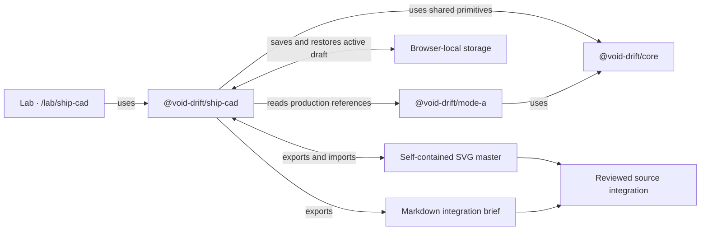

---
generated:
  by: openai-codex/gpt-6.2-sol
  at: "2026-11-27T19:58:04Z"
verified: []
---

# ShipCAD

## Context

Void Drift ship designers need to author low-poly hulls, judge their silhouettes at game scale, and hand off the artwork for integration without changing the game from the editor.

## Blueprint

ShipCAD turns a layered hull draft into an editable SVG master and a separate, reviewable game integration brief.

### Architecture



| Owner | Responsibility |
| --- | --- |
| [Lab](../lab/spec.md) route in `apps/web` | Editor workflow and controls, using shared Lab surfaces at widths of 1280 CSS px and up. |
| `packages/ship-cad` | Authoring document, geometry and lighting, CAD-only colormaps, and the file boundary. Validate external document data with Zod before using it as editor state. |
| `packages/mode-a` | Canonical fleet art, cockpit references and flight scale; owns any ship subsequently integrated into the game. |

### Constraints

| Boundary | Rule |
| --- | --- |
| Scope | Author and inspect ship hulls, not standalone parts, loadouts or flight behaviour. Sketch underlays and fleet references are authoring aids, not ship artwork. |
| Coordinates | The editor is bow-up: `x` increases to starboard, `y` aft, and `z` above the hull plane. Handoff uses `gameX = -y`, `gameY = x`, with one CAD unit per game ship unit before flight scaling. |
| Runtime isolation | Game routes and packages do not import or ship ShipCAD code or colormap tables. Integrating a ship is a source change, not a runtime SVG import. |

## Scenarios

```gherkin
Feature: ShipCAD

  Scenario: Author a layered hull from a sketch
    Given I open ShipCAD in the Lab at a supported viewport width
    When I place a PNG or JPEG reference behind the bow-up grid and edit triangular faces in the object stack
    Then I can adjust the reference scale and opacity without changing the hull
    And the stack order controls overlap between objects
    And mean vertex height controls triangle order within an object

  Scenario: Shape a symmetric hull with asymmetric lighting
    Given a hull object has Mirror X enabled and an off-centre object has it disabled
    When I raise a centreline ridge on the hull
    Then the hull faces mirror across x = 0 and meet at the shared centreline
    And the off-centre object has no generated mirror
    And each face is shaded from its own 3D normal and elevation
    And every face uses one of the 11 discrete shades of its object's ship, weapon or equipment LCH colormap
    And I cannot override an individual face's shade

  Scenario: Place a manufacturer cockpit
    Given the hull has overlapping objects
    When I add and move an Aegis, Daehan or LHI cockpit
    Then it remains above all hull objects at its production size and orientation
    And I can change only its position or remove it after placement

  Scenario: Compare the draft with the fleet
    Given I am editing a hull
    When I change its geometry
    Then I see the updated hull at native scale and at the current production flight scale
    And I can compare it with production fleet silhouettes at a matching scale

  Scenario: Resume the active draft locally
    Given my active working draft has autosaved in this browser
    When I reload ShipCAD in the same browser
    Then the editor restores that draft without an account or a file import
    And SVG export remains the way to make a portable master

  Scenario: Round-trip the SVG master
    Given I have a hull with multiple objects and a placed cockpit
    When I export its SVG master and later import that file
    Then the exported SVG shows the resolved artwork without ShipCAD or external assets
    And its embedded document restores the editable geometry, object order, colormaps, mirror settings and cockpit placements
    And sketch underlays and fleet references do not appear in the exported artwork

  Scenario: Reject an invalid project file
    Given I have a working draft open
    When I import an SVG with missing, invalid or unsupported ShipCAD metadata
    Then ShipCAD reports the import problem and leaves the draft unchanged
    And the imported SVG markup is not mounted in the editor

  Scenario: Hand off a hull without publishing it
    Given I have a hull ready for integration review
    When I export the Markdown brief alongside its SVG master
    Then the brief describes the hull dimensions, resolved facets in game coordinates and draw order, and cockpit placements
    And it leaves flight tuning, loadout and release decisions to the people integrating the ship
    And exporting does not change the game or add a playable ship
```
