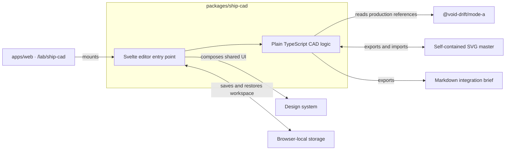

---
generated:
  by: openai-codex/gpt-6.2-sol
  at: "2026-11-27T20:13:13Z"
verified:
  - by: human:ville-takanen
    at: "2026-11-27T20:14:53Z"
---

# ShipCAD

## Context

Void Drift ship designers need to author low-poly hulls, judge them at game scale, and hand off the artwork without changing the game from the editor.

## Blueprint

ShipCAD is a sibling app to the [Game Dev Lab](../lab/spec.md). It authors, inspects and hands off ship hull artwork; it does not design standalone parts, fit loadouts or tune flight.

### Architecture



| Part | Location | Responsibility |
| --- | --- | --- |
| Astro shell | `apps/web/src/pages/lab/ship-cad.astro` | Serves `/lab/ship-cad` and mounts the browser editor. The `/lab/` prefix is shared by sibling apps; ShipCAD does not use the Game Dev Lab layout or the game shell. |
| Svelte editor | `packages/ship-cad/src/editor/` | Owns editing and browser-local workspace state at widths of 1280 CSS px and up. |
| CAD logic | `packages/ship-cad/src/lib/` | Owns hull geometry, artwork colormaps, validation and file exchange. Does not import Svelte or Astro. |
| [Design system](../factory/design-system/spec.md) | Shared UI boundary, independent of the game engine and Astro host | Owns the tokens, surfaces and controls ShipCAD composes. |
| Game library | `packages/mode-a` | Owns production fleet art, cockpit references, flight scale and any ship later integrated into the game. |

`apps/web` declares `@void-drift/ship-cad` as a `workspace:*` dependency and mounts its public editor entry point from the ShipCAD route. Both the editor and CAD logic live in that one pnpm workspace package. ShipCAD has no separate deployment.

### Constraints

| Boundary | Rule |
| --- | --- |
| SVG import | Restore hull state only from supported metadata validated with Zod. Redraw from that state; never mount imported SVG markup in the editor. |
| Portability | The SVG master carries the editable hull and its rendered artwork. The reference sketch and its calibration stay in the local workspace. |
| Runtime isolation | Game routes and packages do not import ShipCAD code or colormap tables, and player-facing bundles do not ship either. Game integration is a reviewed source change, not a runtime import. |
| UI dependencies | ShipCAD does not import from `apps/web`. Reuse Design System primitives through a shared UI boundary; do not copy them into ShipCAD or add Design System code to `packages/core`. |

## Scenarios

```gherkin
Feature: ShipCAD

  Scenario: Author a hull from a sketch
    Given I have a reference sketch behind the bow-up grid
    When I edit a hull made of layered triangular objects
    Then I can mirror individual objects across the centreline
    And ShipCAD shades their faces automatically rather than asking me to paint each face
    And the sketch is visible for tracing but is not part of the hull

  Scenario: Place a production cockpit
    Given I am editing a layered hull
    When I add an Aegis, Daehan or LHI cockpit
    Then it appears above the hull at its production size and orientation
    And the LHI option uses the Wasp cockpit only
    And I can move or remove the cockpit but cannot scale or rotate it

  Scenario: Inspect the hull beside the fleet
    Given I am editing a hull
    When I change its geometry
    Then the native and production flight-scale previews update
    And I can compare the hull with production fleet silhouettes at matching scale

  Scenario: Resume work in the same browser
    Given my workspace has autosaved with a reference sketch
    When I reload ShipCAD in the same browser
    Then the active hull, sketch and its calibration return without a file import

  Scenario: Reopen a portable master
    Given I exported an SVG master from a draft with a reference sketch
    When I open the SVG outside ShipCAD and import it into a fresh ShipCAD workspace
    Then it shows the artwork in a standalone SVG viewer
    And ShipCAD restores the editable hull without the reference sketch or its calibration

  Scenario: Reject a file that cannot restore a hull
    Given I have a working draft open
    When I import an SVG with missing, invalid or unsupported ShipCAD metadata
    Then ShipCAD reports the import problem and leaves my draft unchanged

  Scenario: Hand off without publishing
    Given my hull is ready for review
    When I export its SVG master and Markdown integration brief from the same draft
    Then both describe the same hull for reviewed source integration
    And exporting does not change the game or register a playable ship
```
